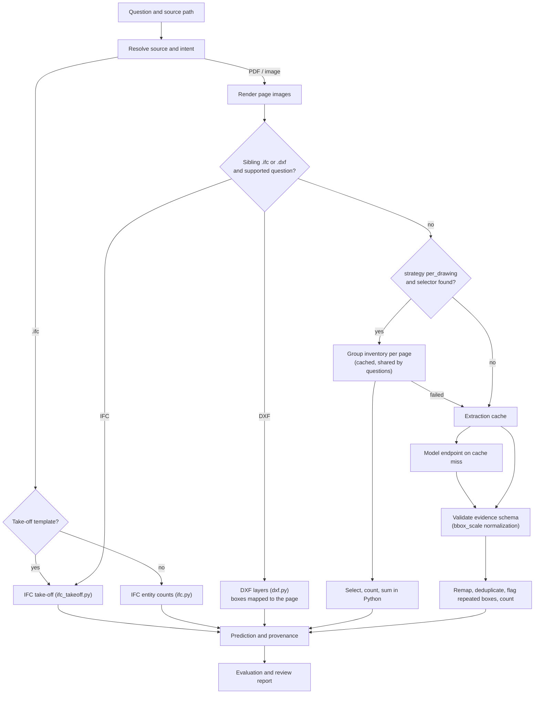

# Architecture and extension guide

DrawingQA separates perception, evidence, deterministic calculation and evaluation. Replacing the VLM should not require changing how a reviewer locates evidence or how a count is calculated.

## Execution flow

`Pipeline.predict` (`pipeline.py`) tries the deterministic routes first and uses the VLM only when none applies:

1. `.ifc` file: IFC take-off if the question matches a take-off template, otherwise the IFC entity-count adapter.
2. Other files: render the page images (also used by the report), then
   - IFC take-off from `<model>.ifc` for `<model>_plan-*.pdf` plans (`pipeline.use_ifc_sibling`);
   - DXF route from a same-named `.dxf` (`pipeline.use_dxf_sibling`);
   - with `pipeline.strategy: per_drawing`, a shared inventory (`inventory.py`) when the question maps to a selector;
   - otherwise the per-question VLM extraction path.

Native routes record their adapter version as the prediction's `model_id` (`ifc-takeoff-v1`, `ifc-entities-v1`, `dxf-layers-v1`); the report derives its per-dataset "route" column from it, and resume accepts these IDs in place of the configured model. Shared inventories set `Prediction.route = "vlm-inventory"`.

## Request strategies and run profiles

`per_question` sends one request per question; canonical count intents already share one request per drawing and category because their prompt omits the question text. `per_drawing` (`inventory.py`) instead asks once per page for every element of a group and answers questions from that list:

| Group | Kinds |
|---|---|
| openings | door, window |
| fixtures | toilet, washbasin, kitchen_sink, bathtub, shower |
| spaces | room (with type, name, number, printed area), apartment, floor |
| structure | stair, column |

`inventory.select` maps a question to a `Selector` (count, count labels, area, sum of areas; kinds, room type, name/number, apartment, indoor-only) using the canonical intents, the Swiss DXF query parser and the IFC storey parser, so the wording rules are shared with the native routes. Questions it cannot express return `None` and use the per-question path. The inventory cache key includes the group prompt and `INVENTORY_VERSION`, not the question. A failed inventory (looping or invalid output, provider error) is remembered for the rest of the run, so each drawing and group fails at most once before falling back. Inventory requests use their own `inventory_max_tokens` and `inventory_extra_body` (`repetition_penalty`), because greedy decoding tends to repeat list items.

Profiles (`AppConfig.profiles`, `--profile`) set the model list and pipeline overrides: `normal`, `reduced` and `gpu`. The GPU profile targets a vLLM server on a rented GPU through an SSH tunnel (`scripts/gpu/`); it differs from `reduced` only in the endpoint, the FP8 checkpoint and the concurrency. `ModelConfig.gpu_cost_per_hour` turns run wall time into `estimated_gpu_cost_usd` in `summary.json`.

## Contracts

| Contract | Responsibility |
|---|---|
| `Question` | Source path, natural-language question, optional page and evaluation-only answer |
| `Intent` | Canonical count category and its counting rule, or a general question |
| `ModelConfig` | Endpoint, actual model ID, sampling, retry policy, `bbox_scale`, optional token prices and GPU hourly rate |
| `DxfQuery`, `TakeoffQuery` | Parsed native-route questions (kind, element, storey/room/name), or none when the wording is unsupported |
| `Extraction` | Model answer, candidate list, coverage assertion, short evidence rationale and warnings |
| `DrawingInventory`, `InventoryItem` | Per-page list of elements of one group (kind, box, label text, number, area, room type, apartment) with a coverage assertion |
| `Selector` | What a question asks of an inventory: operation, kinds and filters |
| `Candidate` | View-relative normalized box, label and counted/uncertain flags |
| `Evidence` | Stable item ID, page, remapped coordinates, provenance (`model_prediction`, `ifc_entity`, `dxf_entity`) and optional IFC GUID |
| `Prediction` | Final/proposed answer, status, evidence, identity hashes, usage and optional ground truth |

Model-produced `complete` is a coverage assertion that can inform abstention; it is not a statistical guarantee. `verified` is false for generated evidence until an independent human review explicitly establishes otherwise. IFC evidence uses native GUIDs and can omit a raster box. DXF evidence boxes come from entity extents, mapped to the PDF page by a per-axis least-squares fit between text positions found in both the DXF and the PDF text layer.

## Native routes

- **DXF (`dxf.py`)**: doors are 5-vertex frames on `DOOR`; windows are outer `WINDOW` polylines; toilets, washbasins, bathtubs and showers are told apart by polyline shape on `FIXTURE`; apartments come from unit labels on `ROOM_TEXT`; room areas are the smallest `ROOM_OUTLINE` polygon containing the room number. A room whose outline area disagrees with its printed area by more than 1% sends the answer to review.
- **IFC take-off (`ifc_takeoff.py`)**: storey membership via containment/aggregation; same-class aggregated parts excluded; quantities from `Qto_*`/`BaseQuantities` with project unit scaling; room area from a stored net area, else half the vertical projection of the space body (equal to the footprint for solids, and robust to surface models). IFC2X3 sanitary and light fixtures are `IfcFlowTerminal` occurrences with a typed product type.

Both parse questions with multilingual keyword patterns, return `None` for unsupported wording and leave those questions to the next route.

## Inference boundaries

The application does not load model weights into the client process. `providers.py` handles the HTTP protocol and returns a content string plus usage. Endpoint-specific model serving belongs in a separate deployment. The adapter does not assume a text-only model can process images merely because it exposes a chat endpoint.

The intent mapper recognizes the current sample's English/Finnish count templates. Unknown scopes or question types must preserve their wording through the general path, rather than silently reducing “windows on the second floor” to “all windows.” New intents require tests for category selection, scope, bilingual equivalents and false matches.

Images and rendered document pages retain their original page coordinate system. Input views may be resized or cropped for model inference. All accepted visual evidence must map back to the page before it enters the report. Tile overlap creates duplicate proposals; overlap suppression is an approximation and should be inspected for adjacent symbols.

## Identity, caching and resume

Run records retain source hashes and configuration identities. Cache entries depend on source content, view preparation, the model and its settings, and the effective prompt. Question answers from the dataset are excluded from inference identity and never sent to providers.

Canonical count extraction is reusable for equivalent English/Finnish questions on the same source/scope. This is an efficiency feature, not an independent multilingual test. When auditing language behavior, run non-canonical question variants separately and document their scope.

Do not reuse a cached or resumed prediction after changing the source, model, prompt or rendering rules. A remote endpoint can change weights behind a constant ID; production deployments should pin model revisions and encode revision identity in the served name/configuration.

## Failure behavior

Recoverable transport failures use bounded retry. Authentication failures, malformed model output, invalid boxes, unsupported formats and unresolved files are explicit outcomes. Batch processing retains per-question errors. A partial document or uncertain count is distinguishable from a successful complete answer; proposed counts remain available for review.

Metrics use ground truth only after inference. Errors and abstentions remain in overall labeled accuracy. Human review exports are a separate artifact so evaluation labels cannot be silently overwritten by generated predictions. Correct totals do not imply correct localization; localization quality requires reviewed instance annotations.

## Supported extensions

1. **Specialist object detector (in progress):** `scripts/detector/` generates YOLO tiles from the even-site Swiss DXFs and trains YOLO11n in a separate AGPL environment. Integration should return the same evidence objects with their own provenance. Keep grouping rules in the deterministic layer. Use reviewed VLM proposals as annotation suggestions, not unverified ground truth. The Swiss training style differs strongly from CubiCasa scans; test transfer before relying on it.
2. **OCR and label association:** Add an OCR backend that retains text boxes and language metadata. Associate labels to room polygons without changing the question/report contracts. A document parser such as Nemotron Parse supplies text/layout evidence, not automatically a door/window ontology.
3. **Room topology:** Add room polygons and door adjacency only when adjacency, access or room-scoped questions need them. Preserve source transforms and uncertainty.
4. **CAD rendering:** The DXF route reads one layer convention (Swiss). Other conventions need their own layer mapping; DWG and arbitrary DXF need a sandboxed conversion into page views that retains layer/entity IDs. Do not run arbitrary embedded scripts/macros from drawing files.
5. **BIM geometry:** Unit-aware quantities, storey traversal and space-geometry areas exist in `ifc_takeoff.py`. Next: map cited GUIDs onto the rendered plan (the `.svg` export beside each `ifc_models` plan carries positions), answer free-text BIM questions, and add a 3D viewer that selects cited GUIDs.
6. **Search over a collection:** Index stored inventories and validated properties. Translate collection questions to constrained queries. Image embeddings may locate candidate documents but do not establish exact counts.
7. **Learned verification:** Compare evidence against an independent detector or geometry checks, then escalate disagreements. Multiple VLMs agreeing is not sufficient proof by itself.

## Production deployment work

The package provides reusable application components and a batch CLI. Before exposing it as a service, add authenticated request handling, per-user dataset isolation, a durable work queue, bounded worker resources, secrets management, retention controls and operational monitoring. Hashes are reproducibility aids, not an access-control system.

Keep source drawings, model-generated evidence, human corrections and benchmark ground truth in separate records. Maintain model/prompt/rendering versions with every run. Track failure rate, abstention rate, cache hit rate, latency percentiles and actual infrastructure costs alongside accuracy. Use a representative source/property-grouped holdout set before expanding scope.

The current report visualizes evidence rather than private chain-of-thought. This makes the review interface stable as underlying models improve: engineers can still inspect the cited object or native BIM entity in the source.
